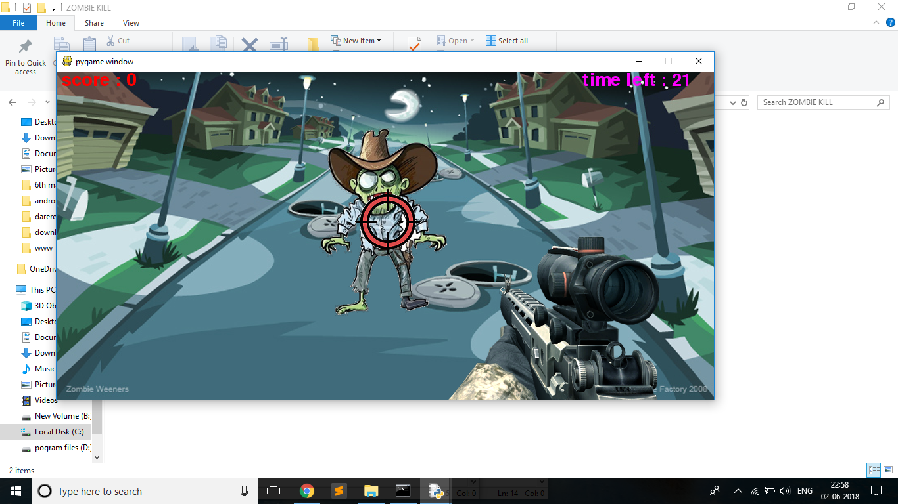
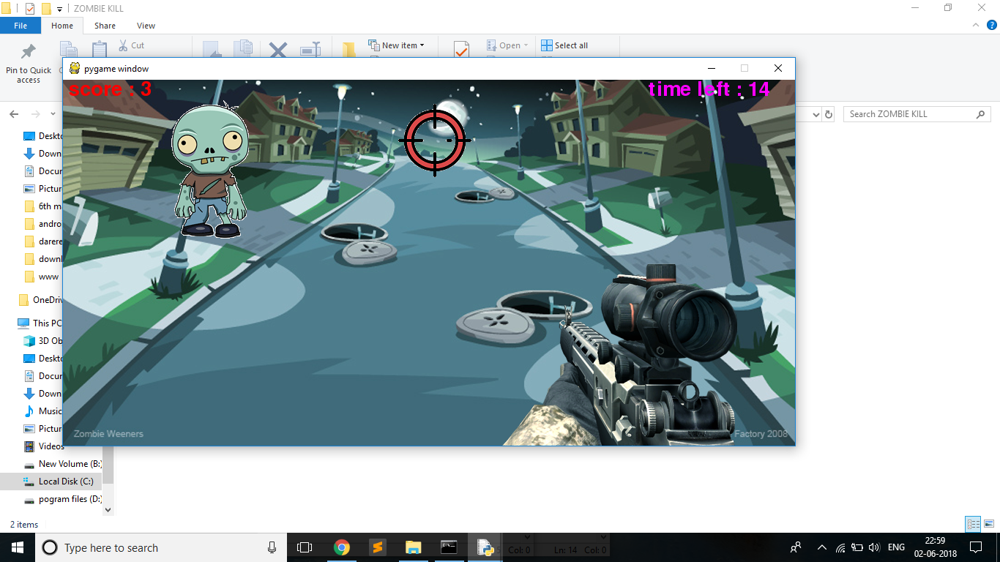
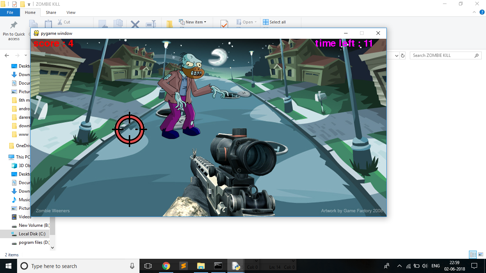
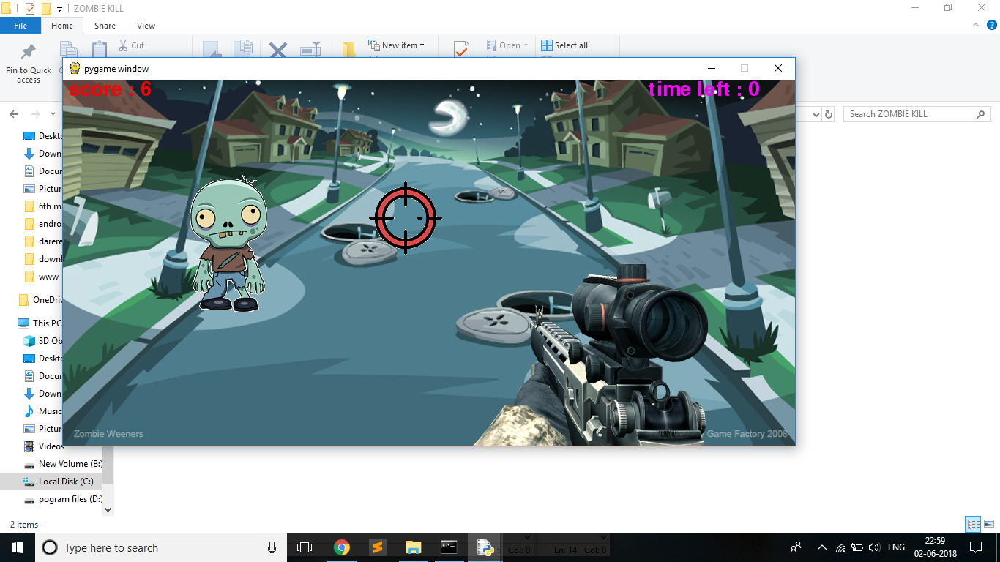
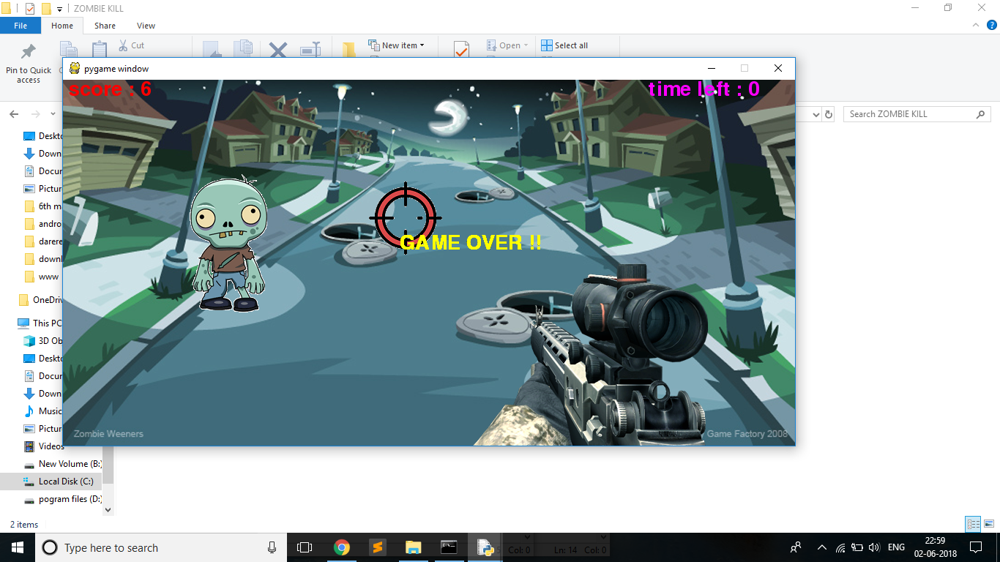

# Zombie-Kill


```
 ███████╗  ██████╗  ███╗   ███╗ ██████╗  ██╗ ███████╗     ██╗  ██╗ ██╗ ██╗      ██╗
 ╚══███╔╝ ██╔═══██╗ ████╗ ████║ ██╔══██╗ ██║ ██╔════╝     ██║ ██╔╝ ██║ ██║      ██║
   ███╔╝  ██║   ██║ ██╔████╔██║ ██████╔╝ ██║ █████╗       █████╔╝  ██║ ██║      ██║
  ███╔╝   ██║   ██║ ██║╚██╔╝██║ ██╔══██╗ ██║ ██╔══╝       ██╔═██╗  ██║ ██║      ██║
 ███████╗ ╚██████╔╝ ██║ ╚═╝ ██║ ██████╔╝ ██║ ███████╗     ██║  ██╗ ██║ ███████╗ ███████╗
 ╚══════╝  ╚═════╝  ╚═╝     ╚═╝ ╚═════╝  ╚═╝ ╚══════╝     ╚═╝  ╚═╝ ╚═╝ ╚══════╝ ╚══════╝

```


Here is a game built my me using python named Zombie Kill. This game is built using a module named Pygame.

This game is a small python game that is based on killing zombies. It is a static and simple game that I have built using core python and its modules.

This is just a beta version. Am working on it to improve it UI. Will give an update as soon as i bring something new. Till then stay tuned and keep enjoying.

## ScreenShots











